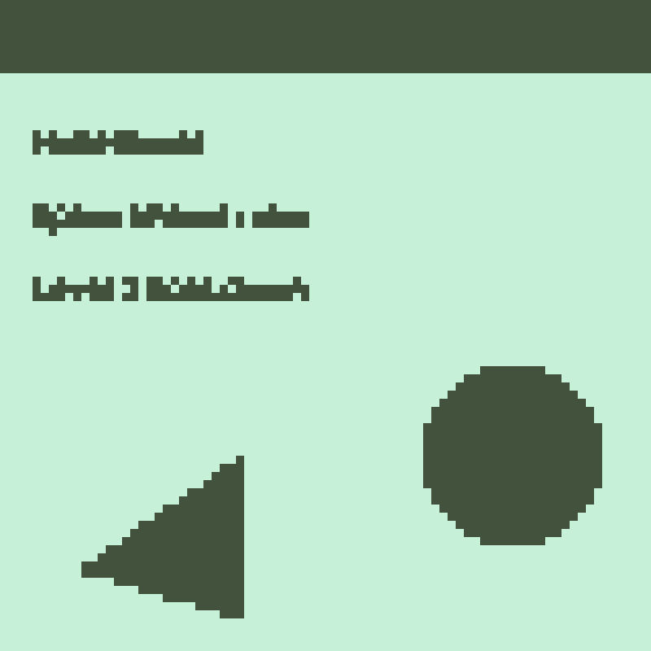

# Pixelated

An always-on-top, click-through overlay that pixelates **everything on your screen**, live.
Your apps keep working as normal underneath: clicks and keystrokes go straight through the overlay.

By default it uses the **Space Impact look**: just two tones, the dark and light green of the
Nokia 3310 LCD (`#43523D` on `#C7F0D8`). A block turns dark when it is darker than the screen's
average brightness, so text and shapes become chunky dark sprites on the green LCD. Full colour is still available.



There are two versions:
- **Desktop** (`pixelated.py`): Windows and macOS, with a picom shader for Linux
- **Android** (`android/`): includes a floating on/off switch, see [Android](#android)

## How it works (desktop)

Each monitor gets a borderless, transparent window that never takes focus. About 30 times a second it
captures the screen *underneath itself*, averages every N×N block into one pixel, and draws the result
back at full size with nearest-neighbour scaling.

The overlay stays out of its own capture, which is what lets it see the screen beneath it:

| Platform | How the overlay stays out of the capture |
|---|---|
| Windows 10 (2004+) / 11 | `SetWindowDisplayAffinity(WDA_EXCLUDEFROMCAPTURE)` |
| macOS | `CGWindowListCreateImage(... OnScreenBelowWindow ...)` |
| Linux | Not possible from an app, so use the picom shader (below) |

## Install & run (Windows / macOS)

Requires Python 3.9+.

```bash
python -m venv .venv
# Windows: .venv\Scripts\activate     macOS: source .venv/bin/activate
pip install -r requirements.txt
python pixelated.py                 # default 1 px blocks, 30 fps
python pixelated.py --block 24      # chunkier
python pixelated.py --fps 60        # smoother (more CPU)
python pixelated.py --color         # full colour instead of the 2-tone Space Impact look
```

**macOS:** the first time you run it, grant *Screen Recording* permission to your terminal (or Python)
under System Settings → Privacy & Security, then start the app again. Global hotkeys also need the
*Accessibility* permission.

## Controls

A tray / menu-bar icon (four coloured squares) gives you:
- **Pixelate screen**: turn the effect on or off
- **Space Impact style (2 tones)**: switch between the Nokia LCD look and full colour
- **Pixel size**: 1 to 64 px
- **Quit**

Global hotkeys (when `pynput` is installed):

| Keys | Action |
|---|---|
| `Ctrl+Alt+P` | Toggle pixelation |
| `Ctrl+Alt+T` | Toggle 2-tone / full colour |
| `Ctrl+Alt+]` | Bigger pixels |
| `Ctrl+Alt+[` | Smaller pixels |
| `Ctrl+Alt+Q` | Quit |

## Linux

X11 and Wayland give an app no way to hide its own window from a screen capture, so on Linux the
pixelation runs inside the compositor. With [picom](https://github.com/yshui/picom) v10 or newer:

```bash
picom --backend glx --window-shader-fg "$PWD/linux/pixelate.glsl"
```

Change `BLOCK` at the top of `linux/pixelate.glsl` to set the pixel size.

## Build a standalone executable (optional)

```bash
pip install pyinstaller
pyinstaller --onefile --windowed --name Pixelated pixelated.py
```

## Android

`android/` is a native Kotlin app (Android 8.0+). A small **floating switch** sits over every app:
tap it to turn pixelation on or off, drag it anywhere. The notification also has **Turn off/on** and **Stop**.

### Get the APK
Every push that touches `android/` is built by GitHub Actions (`.github/workflows/android.yml`).
Open the latest **Android** run in the repo's *Actions* tab and download the `Pixelated-debug-apk` artifact.
Or build it yourself with the Android SDK installed:

```bash
cd android
./gradlew assembleDebug        # -> app/build/outputs/apk/debug/app-debug.apk
./gradlew testDebugUnitTest    # engine tests, run on the JVM
```

### Using it
1. Open **Pixelated**, choose a pixel size (1 to 80 px, default 1), leave **Space Impact style** on (or turn it off for full colour), and tap **Start pixelating**.
2. Allow **Display over other apps** (first time only), then tap Start again.
3. When Android asks what to share, pick **Entire screen**.

### How it works, and its limits
Android gives apps no way to leave their own overlay out of a screen capture. Since Android 12,
touches also only pass through another app's overlay if it is at most **80% opaque**. So the app:

1. captures the screen at half resolution (MediaProjection),
2. draws the pixel blocks in an overlay at 80% opacity (90% on Android 11 and older),
3. "un-blends" each capture: because it knows exactly what it drew, it solves
   `captured = 0.8 x overlay + 0.2 x screen` for the real screen underneath. A tiny black-and-white
   barcode in the top-left corner says which frame each capture contains, and its black/white pairs
   also let the app measure the real blend strength on your device and correct for it.

The real screen stays faintly visible (20%) through the pixels. The status bar, navigation bar,
keyboard and system dialogs sit above app overlays, so they are not pixelated. Apps that block screenshots
(banking, DRM video) come out dark. When the screen is still the app does no work, so it saves battery. At 1 px the app has to
process every screen pixel, so it redraws more slowly (roughly 10–15 frames a second on a mid-range
phone while the screen is moving); 2 px and larger stay smooth.
